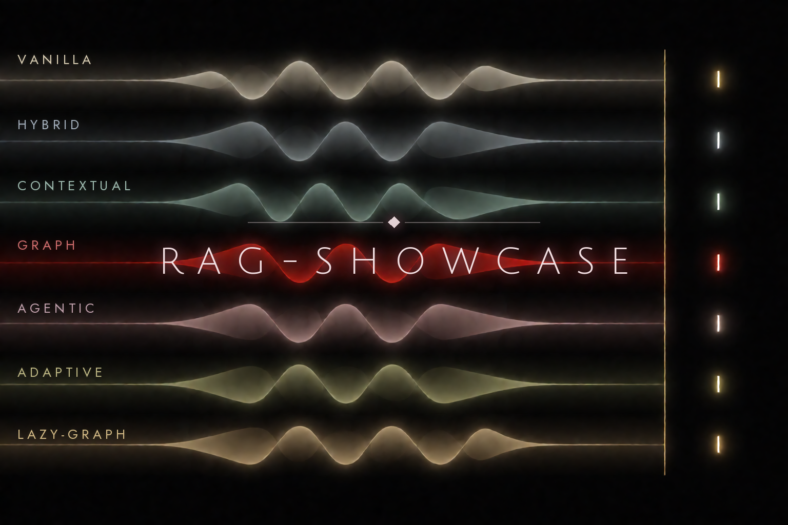

<!-- opener:title -->
<h1 align="center">RAG Showcase</h1>
<!-- /opener:title -->

<!-- opener:tagline -->
<p align="center"><strong>Seven RAG approaches. One shared stack. Measured side by side.</strong></p>
<!-- /opener:tagline -->

<!-- opener:support -->
<p align="center">Compare vector, hybrid, contextual, graph, agentic, adaptive, and lazy-graph retrieval through one reproducible Atlas evaluation harness.</p>
<!-- /opener:support -->

<!-- opener:badges -->
<p align="center">
  
  
  
</p>
<!-- /opener:badges -->

<!-- opener:tech-badges -->
<p align="center">
  
  
  
  
</p>
<p align="center">
  
  
  
  
</p>
<p align="center">
  
  
  
  
  
</p>
<!-- /opener:tech-badges -->

<!-- opener:summary -->
RAG Showcase compares seven retrieval strategies through Open WebUI. Ask the
same question in a multi-model chat and compare the responses. The approaches
share an Atlas stack, dataset profile and embedding model. Responses can include
available evidence and metrics.

Start with the committed measured results or run a local comparison. Atlas owns
the shared services; this repository supplies the approach plugin, corpus ladder,
tuning flavors and evaluation harness. Provider and model choices are configurable.
<!-- /opener:summary -->

<p align="center">
  <a href="docs/guide/quickstart.md"><strong>Quick Start</strong></a>&nbsp;&nbsp;·&nbsp;&nbsp;
  <a href="docs/evaluation-results.md"><strong>Measured Results</strong></a>&nbsp;&nbsp;·&nbsp;&nbsp;
  <a href="docs/architecture.md"><strong>Architecture</strong></a>
</p>

<!-- opener:results -->
> **Latest benchmark (2026-07-17):** all **380/380** answer cells completed across seven base approaches, twelve query-time flavors, and three datasets. Winners changed with dataset complexity. See the **[full sortable results](docs/evaluation-results.md)**, [methodology](docs/evaluation-methodology.md), and [artifact ledger](docs/results/README.md).
<!-- /opener:results -->

## 1. Capabilities

Compare vector, hybrid, contextual, graph, agentic, adaptive and experimental
lazy-graph retrieval through one interface. Tuned flavors provide additional
model aliases. The committed benchmark records 380 completed answer cells across
three datasets; winners depend on dataset structure and configuration.

## 2. Requirements and local setup

Install Git, Bash, Make, `uv` and Python 3.10 or newer. Docker must be running
with Compose 2.20.3 or newer; Atlas recommends 2.26.0+. Check the
[hardware guide](docs/hardware.md) for RAM, disk and model requirements before
starting the stack. The default local models can download several GB.

```bash
git clone https://github.com/thekaveh/rag-showcase.git
cd rag-showcase
git submodule update --init --recursive
```

The committed manifest selects an Atlas-supported LLM source automatically.
Provider/model overrides and the optional full MultiHop corpus prerequisites are
in [Quick Start](docs/guide/quickstart.md). Follow those instructions before
starting if you need more than the bundled keyword documents.

From the checkout root:

```bash
./scripts/start-all.sh
```

This starts the showcase's Atlas stack, prepares its corpus and ingestion, waits
for readiness and prints the Open WebUI URL. Do not edit `infra/` here. Startup
can download models and write persistent data; confirm the selected project and
resources before running it alongside other Atlas consumers.

## 3. Make your first comparison

1. Open the URL printed by startup and complete Open WebUI sign-in/setup if prompted.
2. Start a multi-model chat and select `vanilla-rag` and `hybrid-rag`.
3. Ask: `What does error code WIDGET-ERR-7741 mean and how do I reset it?`
4. Compare both responses and any available evidence. A response from each selected model is the first useful result; neither model is guaranteed to win.
5. Add other approaches as resources permit. Lazy graph remains experimental and is excluded from the backward-compatible default matrix.

This query is from [the demo matrix](demo/queries.yaml) and uses bundled keyword
documents. For persisted measurements and fair comparisons, use the
[evaluation methodology](docs/evaluation-methodology.md) and committed
[results](docs/evaluation-results.md). Design intent is distinct from a measured winner.

Stop the selected showcase stack with `./scripts/stop-all.sh`. A cold Atlas stop
**erases volumes and data**; it is not the routine shutdown command. The
[operations guide](docs/guide/operations.md) preserves reset and troubleshooting
conditions.

## 4. The Seven Approaches

| Model | Approach | Designed to win on |
|---|---|---|
| [`vanilla-rag`](docs/approaches.md#3-vanilla-rag) | dense top-k → stuff → one call (baseline) | — (the control) |
| [`hybrid-rag`](docs/approaches.md#4-hybrid-rag) | Weaviate hybrid retrieval (BM25+dense) → TEI rerank; **not graph RAG** | exact keyword / ID queries |
| [`contextual-rag`](docs/approaches.md#5-contextual-rag) | Anthropic Contextual Retrieval over context-prefixed chunks | context-starved chunks |
| [`graph-rag`](docs/approaches.md#6-graph-rag) | Atlas LightRAG over extracted entities, relationships, and vector context | graph-shaped relationship questions |
| [`agentic-rag`](docs/approaches.md#7-agentic-rag) | ReAct loop over vector + graph tools | multi-hop / comparative questions |
| [`n8n-adaptive-rag`](docs/approaches.md#8-n8n-adaptive-rag) | low-code Adaptive-RAG workflow (routes by complexity) | mixed simple+complex batches |
| [`lazy-graph-rag`](docs/approaches.md#9-experimental-lazy-graph-rag) | deterministic concept graph + budgeted query-time expansion | graph-shaped data under a lower indexing budget |

The last column is the design intent behind each demo query family, not a measured
result — several intended contrasts did not materialize in the committed runs (the
measured per-query winners live in
[`docs/dataset-complexity-report.md`](docs/dataset-complexity-report.md#5-base-family-per-query-winners) §5).

For exact internal steps, dependencies, tuning variables, and current measured
performance for each approach, see [`docs/approaches.md`](docs/approaches.md).

### 4.1 Experimental status

[`lazy-graph-rag`](docs/lazy-graph-rag.md) combines vector seeds with deterministic,
budgeted concept-graph expansion. It is a separate experimental approach, not a
LightRAG flavor. In the 2026-07-17 base-approach ladder it tied for third on
baseline, ranked first on graph-native, and tied for second on cyber-threat data. It
remains experimental and off by default while its lightweight concept extraction and
co-occurrence semantics are evaluated on additional corpora.

## 5. Architecture and operations

The approach plugin runs inside Atlas's FastAPI backend. LiteLLM exposes its
model aliases to Open WebUI and the evaluation harness. Atlas owns shared
services and ingestion; the showcase owns approach-specific behavior and comparison.

- [Architecture and flow diagrams](docs/architecture.md)
- [Operations and configuration](docs/guide/operations.md)
- [Hardware sizing](docs/hardware.md)
- [Corpus](corpus/README.md) and [n8n workflow](n8n/README.md)

## 6. Development and checks

Run local unit tests from the checkout root:

```bash
uv run pytest backend_plugins
uv run ruff check .
```

The live integration harness needs an explicitly selected running stack. Its
`infra/.env` fallback can target the local gateway, so inspect that target first.
See [Quick Start development instructions](docs/guide/quickstart.md#5-development-and-testing)
for integration tests, dependency preflight and documentation tooling.

## 7. Further documentation

- [Approach internals](docs/approaches.md) and [flavor tuning](docs/approach-flavor-tuning.md)
- [Evaluation methodology](docs/evaluation-methodology.md), [measured leaderboards](docs/evaluation-results.md) and [artifact ledger](docs/results/README.md)
- [Dependency contracts](docs/dependency-contracts.md) and [Atlas reuse assessment](docs/atlas-reuse-assessment.md)
- [Documentation reference](docs/reference.md): current guides and historical specifications/plans
- [Changelog](CHANGELOG.md), [Security](SECURITY.md) and [Apache-2.0 license](LICENSE)
